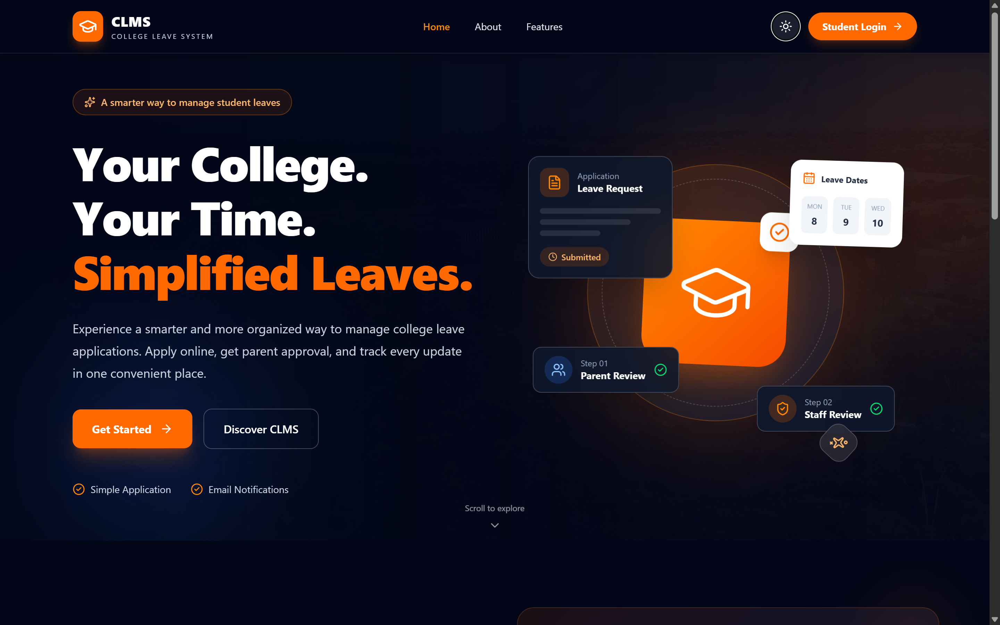
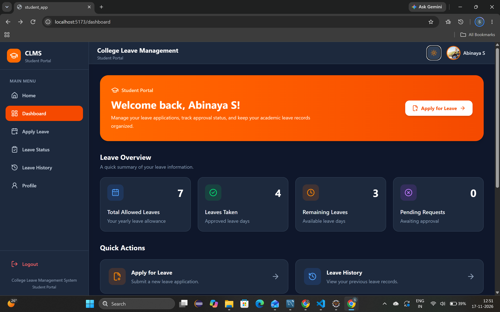
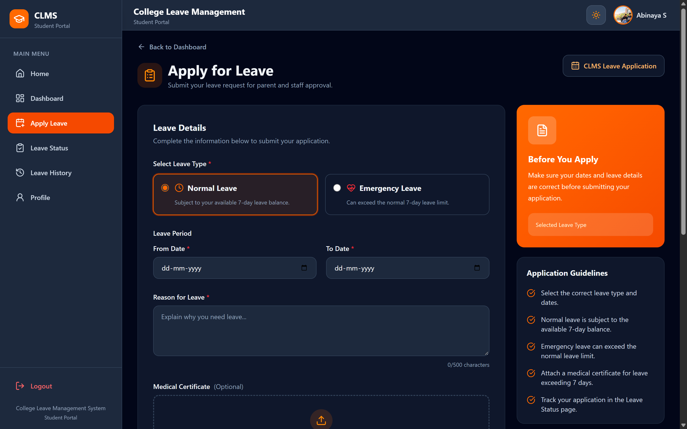
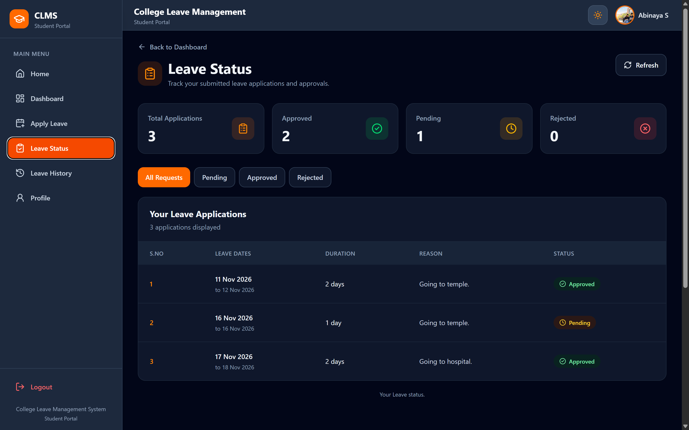
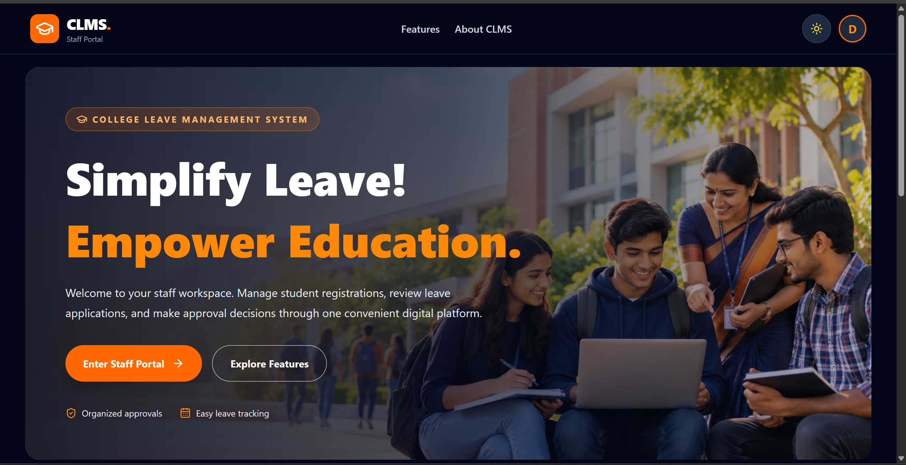
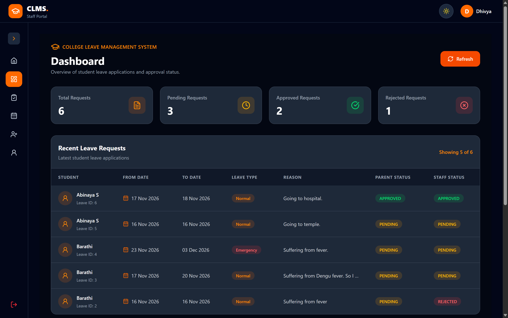
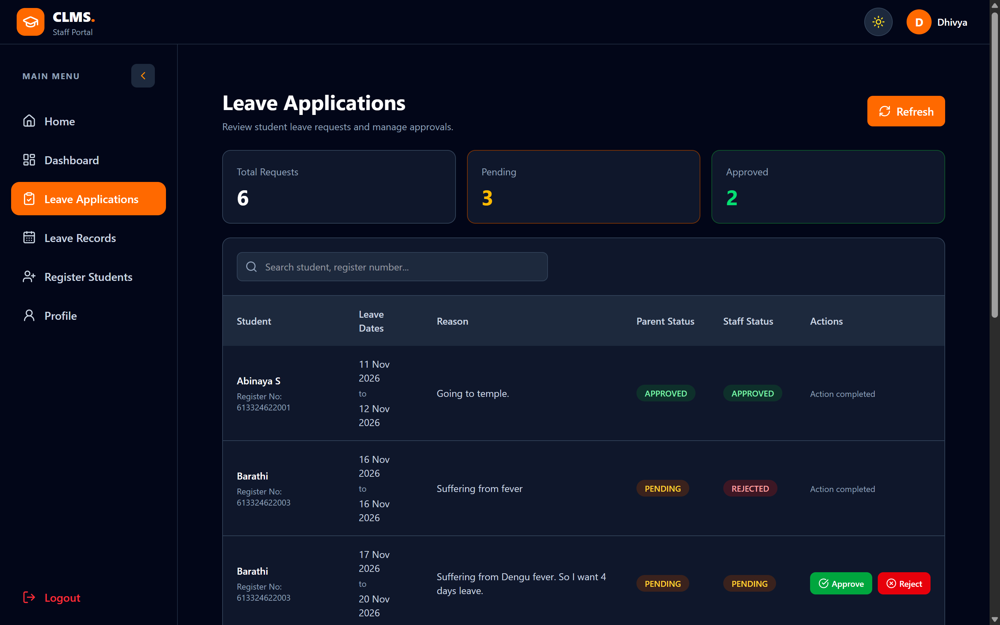
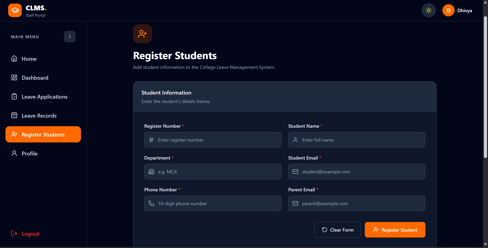

# College Leave Management System (CLMS)

A web-based College Leave Management System designed to simplify and digitize the leave application and approval process for students, parents, and college staff.

## Overview

The College Leave Management System provides a centralized platform where students can apply for leave, parents can provide approval through email, and staff can review and manage leave requests.

The project consists of three integrated applications:

- **Backend:** REST API developed using Spring Boot.
- **Student Application:** React-based interface for students.
- **Staff Application:** React-based interface for college staff.

## Features

### Student Module

- Student login and authentication using JWT.
- Student dashboard with leave statistics.
- Apply for leave with date range and reason.
- Upload medical certificates when required.
- Track leave application status.
- View leave history.
- Update profile information and profile image.
- Forgot password and OTP-based password reset.
- Receive email notifications about leave applications.

### Staff Module

- Staff login and authentication using JWT.
- Staff dashboard.
- Register students.
- View and manage student leave applications.
- Approve or reject leave requests.
- View leave records.
- Update profile and profile image.
- Receive relevant email notifications.

### Parent Approval Module

- Receive leave application notifications through email.
- Approve or reject student leave requests through email links.
- Track parent approval status as part of the leave workflow.

## Technology Stack

| Layer | Technologies |
|---|---|
| Backend | Java, Spring Boot |
| Backend APIs | Spring Boot REST API |
| Database | MySQL |
| ORM | Spring Data JPA, Hibernate |
| Frontend | React.js, JavaScript |
| Styling | Tailwind CSS |
| API Communication | Axios |
| Data Fetching | TanStack Query |
| Authentication | JWT |
| Password Security | BCrypt |
| Email Notifications | Spring Boot Mail |
| Profile Image Storage | Cloudinary |
| Build Tool | Maven |
| Development Tools | Eclipse, Visual Studio Code, Postman |
| Version Control | Git, GitHub |

## Project Structure

```text
StudentCLMS/
│
├── CollegeLeaveManagementSystem/       # Spring Boot Backend
│   ├── src/
│   │   ├── main/
│   │   │   ├── java/in/clms/
│   │   │   │   ├── config/
│   │   │   │   ├── controller/
│   │   │   │   ├── dto/
│   │   │   │   ├── enums/
│   │   │   │   ├── exception/
│   │   │   │   ├── exceptions/handler/
│   │   │   │   ├── model/
│   │   │   │   ├── repository/
│   │   │   │   ├── service/
│   │   │   │   ├── service/impl/
│   │   │   │   └── util/
│   │   │   └── resources/
│   │   │       └── application.properties
│   │   └── test/
│   ├── .mvn/wrapper/
│   ├── mvnw
│   ├── mvnw.cmd
│   └── pom.xml
│
├── student_app/                        # Student React Application
│   ├── public/
│   │   ├── images/
│   │   └── videos/
│   ├── src/
│   │   ├── assets/
│   │   ├── components/
│   │   ├── context/
│   │   ├── pages/
│   │   └── services/
│   ├── package.json
│   ├── package-lock.json
│   └── vite.config.js
│
├── staffapp/                           # Staff React Application
│   ├── public/
│   │   └── images/
│   ├── src/
│   │   ├── api/
│   │   ├── assets/
│   │   ├── components/
│   │   └── pages/
│   ├── package.json
│   ├── package-lock.json
│   └── vite.config.js
│
├── screenshots/                        # Application Screenshots
│
├── .gitignore
└── README.md
```

## Application Workflow

1. Staff registers a student in the system.
2. The student sets up their password and logs in.
3. The student submits a leave application.
4. The parent receives an email requesting approval.
5. The parent approves or rejects the request.
6. After parent approval, the staff can review the leave application.
7. Staff approves or rejects the request.
8. The student can view the updated leave status through their email and in dashboard.

## Installation and Setup

### Prerequisites

Install the following before running the project:

- Java Development Kit (JDK)
- MySQL Server
- Node.js and npm
- Git
- Eclipse IDE or another Java IDE
- Visual Studio Code

### 1. Clone the Repository

```bash
git clone https://github.com/Rajashree60404/CollegeLeaveManagementSystem.git
```

Navigate into the project:

```bash
cd CollegeLeaveManagementSystem
```

### 2. Backend Setup

Navigate to the backend folder:

```bash
cd CollegeLeaveManagementSystem
```

Configure the following environment variables:

| Variable | Purpose |
|---|---|
| `DB_USERNAME` | MySQL username |
| `DB_PASSWORD` | MySQL password |
| `MAIL_USERNAME` | Email account used for notifications |
| `MAIL_PASSWORD` | Email app password |
| `JWT_SECRET` | Secret key for JWT generation |
| `CLOUDINARY_CLOUD_NAME` | Cloudinary cloud name |
| `CLOUDINARY_API_KEY` | Cloudinary API key |
| `CLOUDINARY_API_SECRET` | Cloudinary API secret |


Update the database configuration if necessary in `src/main/resources/application.properties`.

Run the backend using the Maven wrapper on Windows:

```bash
mvnw.cmd spring-boot:run
```

Backend default URL:

```text
http://localhost:8082
```

### 3. Student Application Setup

Open a new terminal from the project root:

```bash
cd student_app
npm install
npm run dev
```

### 4. Staff Application Setup

Open another terminal from the project root:

```bash
cd staffapp
npm install
npm run dev
```

Ensure both frontend API configurations point to the running backend.

## Screenshots

### Student Application

**Student Home**



**Student Dashboard**



**Apply Leave**



**Leave Status**



### Staff Application

**Staff Home**



**Staff Dashboard**



**Leave Applications**



**Register Students**



## Future Enhancements

- Migration towards a microservices architecture.
- Deployment to a cloud platform.
- Automated testing and CI/CD integration.
- Enhanced analytics and reporting.
- Role-based access control improvements.

## Author

**Rajashree D**

Master of Computer Applications (MCA)

## Project Information

- **Project Name:** College Leave Management System
- **Repository:** [College Leave Management System](https://github.com/Rajashree60404/CollegeLeaveManagementSystem)

---

*Developed to simplify and digitize the college leave management process.*
